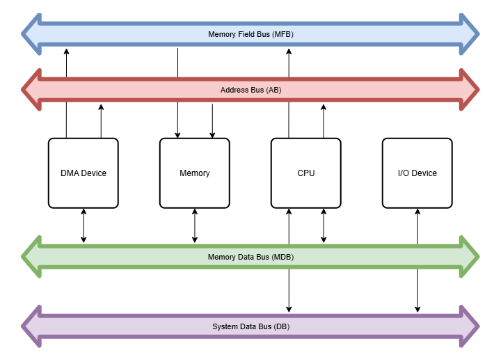

# Architecture

## 1. Purpose
Defines the programmer-visible machine model. This includes what software can observe and rely on.

---

## 2. General System Data Path

---

## 3. Scope
Includes:
- Architectural registers ([Registers §2](./01-registers.md#2-architectural-registers))
- Memory model and addressing (fields, 12-bit addressing)
- Interrupt visibility (IE and /INT_REQ interaction)

Excludes:
- Execution behavior ([Microarchitecture](../03-microarchitecture/README.md))
- Instruction semantics ([Instruction Set Architecture](../02-isa/README.md))
- Control signals ([Control](../04-control/README.md))

---

## 4. Model Summary
- All state visible to software is represented as registers.
- Memory is addressed via fielded 12-bit addressing.
- An interrupt is taken at an instruction's completion when IE is set, II is clear, and /INT_REQ is asserted ([Interrupt Recognition](../08-interrupts-and-skip/02-interrupt-recognition-and-sequencing.md)).

---

## 5. Related Documents
- [01-registers.md](01-registers.md)
- [02-dataflow-and-bus-model.md](02-dataflow-and-bus-model.md)
