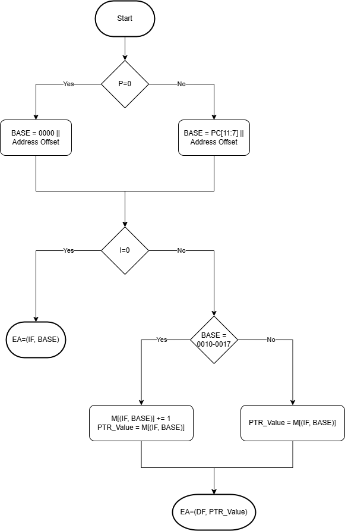

# Effective Address (EA) Generation Algorithm

## 1. Scope

Applies only to Memory Reference Instructions (MRI).  

See:  
- [Encoding model](./00-encoding-model.md)
- [Addressing model](./05-addressing-model.md)

---

## 2. Notation

All final effective addresses are expressed as:

```
FXXXX
```

Where:

- F = field  
- XXXX = 12-bit address  

---

## 3. Overview

The EA as a logical construct is formed by:

1. Selecting a EA_ADDR address using the page bit (P)
2. Resolving direct or indirect addressing (mutually exclusive)
3. Applying field selection (IF or DF)

EA_logical = (EA_fld, EA_ADDR)



---

## 4. EA_ADDR Usage by Phase

EA_ADDR is a phase-dependent working value:

- During FETCH:
  EA_ADDR holds the current page or zero page address derived from IR and the instruction's address

- During DEFER (if indirect):
  EA_ADDR is updated with the resolved pointer value

- At entry to EXECUTE:
  EA_ADDR contains the final operand address

EA_ADDR must not be assumed to be final prior to EXECUTE

---

## 5. Inputs

- IR bits: I, P, offset[6:0]  
- the instruction's address (12-bit)  
- IF (Instruction Field)  
- DF (Data Field)  
- Memory M[]  

---

## 6. Step 1: EA_ADDR Address Formation (IF domain)

The EA_ADDR address is always initially formed in the IF domain, regardless of addressing mode.

If P = 0:

```
EA_ADDR = 0000 || offset
```

If P = 1:

```
EA_ADDR = IA[11:7] || offset
```

IA is the address from which the instruction was fetched, the PC before it is incremented, so an instruction at the last word of a page addresses its own page ([Addressing Model §8](./05-addressing-model.md#8-direct-addressing-i--0)). The CPU holds it in MA from FETCH TP1.

---

## 7. Step 2A: Direct Addressing Path (I = 0)

Direct addressing does not involve indirection.

```
EA_field = IF
EA_ADDR  = EA_ADDR

EA = (EA_field, EA_ADDR)
STOP
```

Properties:

- Uses IF for both EA_ADDR formation and final access  
- No interaction with DF  

---

## 8. Step 2B: Indirect Addressing Path (I = 1)

Indirect addressing resolves a pointer stored in memory.

### 8.1 Step 2B.1: Pointer Location (IF domain)

The pointer location is defined by EA_ADDR in the IF domain.

---

### 8.2 Step 2B.2: Auto-Index Handling

If EA_ADDR is in the auto-index range:

```
0010–0017 (octal)
```

Then:

```
M[(IF, EA_ADDR)] = M[(IF, EA_ADDR)] + 1
PTR_value     = M[(IF, EA_ADDR)]
```

Else:

```
PTR_value = M[(IF, EA_ADDR)]
```

---

### 8.3 Step 2B.3: Final EA Formation

```
EA_field = DF                       for AND, TAD, ISZ, DCA
EA_field = IF (after any pending    for JMP, JMS
           field change)
EA_ADDR  = PTR_value

EA = (EA_field, EA_ADDR)
STOP
```

The data field applies only to the operands of AND, TAD, ISZ, and DCA. A JMP or JMS target, including the word in which JMS stores its return address, is in the instruction field, after any pending CIF, RMF, or RTF change is applied ([Addressing Model §7](./05-addressing-model.md#7-if-vs-df-correct-architectural-rule)).

---

## 9. Invariants

- EA_ADDR is always formed using IF  
- Direct (I = 0) uses IF for final memory access  
- Indirect (I = 1):
  - Pointer location is (IF, EA_ADDR)  
  - Final EA is (DF, PTR_value) for AND, TAD, ISZ, and DCA, and (IF, PTR_value) for JMP and JMS, after any pending field change  
- Auto-index:
  - Applies only when I = 1  
  - Occurs before pointer use  
  - Operates in IF domain  
- Direct and indirect are mutually exclusive execution paths  

---

## 10. Notes

- Pointer location is always addressed in IF  
- Pointer value is interpreted as an address in DF for AND, TAD, ISZ, and DCA, and in IF for JMP and JMS  
- Indirect addressing enables cross-field data access via DF  

