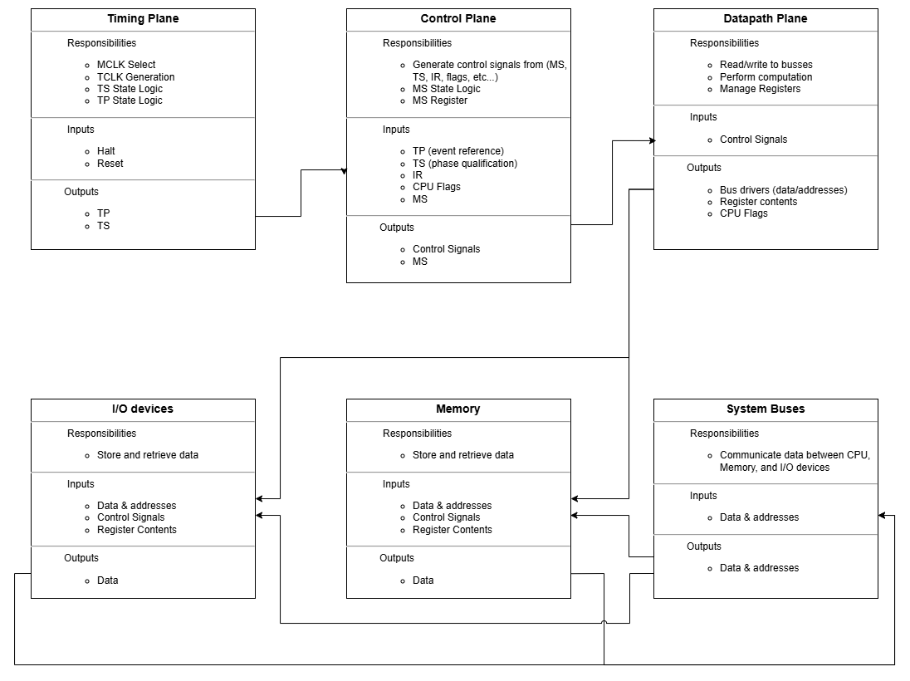
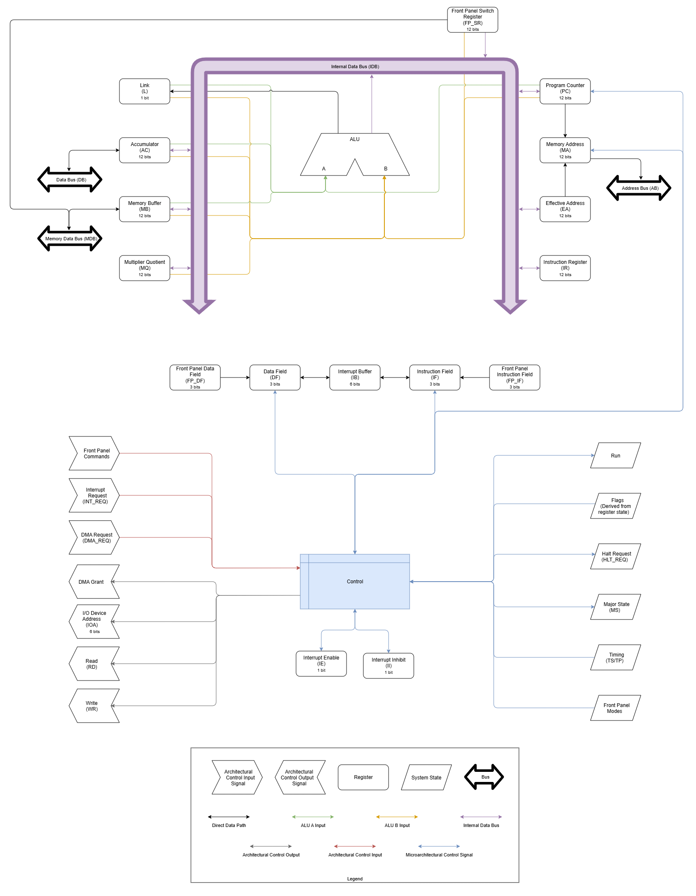

# Microarchitecture

Reference Diagram:

## 1. Purpose

Defines how ISA behavior is executed over time using the system’s timing and control model.

This layer specifies:
- Execution ordering
- Operation composition
- Mapping from ISA semantics to control behavior

It describes how behavior occurs, not what the behavior is.

---

## 2. Scope

Includes:
- Execution over microstates (MS, TS)
- Ordering of operations within an instruction
- Composition rules for OPR instructions
- Interaction between control outputs and datapath behavior

Excludes:
- Instruction semantics ([02-isa/README.md](../02-isa/README.md))
- Control signal definitions ([04-control/README.md](../04-control/README.md))
- Timing signal definitions ([09-timing/README.md](../09-timing/README.md))

---

## 3. General CPU Microarchitecture

---

## 4. Execution Model

μstate = (MS, TS)

- MS: Major State
- TS: Timing State

Behavior is evaluated during TS and committed at TP.
All state changes occur only at TP.

Effective addresses are implemented as:

    EA_logical = (EA_FIELD, EA_ADDR)

Microarchitecture operates directly on EA_ADDR and selects EA_FIELD via IF/DF control.

### 4.1 Instruction Path

Every instruction starts in FETCH, and completes at the TP4 of its last major state:

| Instruction | Major states | Completes in |
|---|---|---|
| OPR (all groups), direct JMP | FETCH | FETCH |
| JMP I | FETCH, DEFER | DEFER |
| AND, TAD, ISZ, DCA, JMS, direct | FETCH, EXECUTE | EXECUTE |
| AND, TAD, ISZ, DCA, JMS, indirect | FETCH, DEFER, EXECUTE | EXECUTE |
| IOT | FETCH, EXECUTE | EXECUTE |

At an instruction's completion, control enters INTERRUPT for a valid interrupt request, otherwise DMA for a DMA request, otherwise the next FETCH. INTERRUPT always returns to FETCH; DMA continues a burst or returns to FETCH.

---

## 5. Relationship to ISA

ISA defines the interface that the programmer uses to produce behavior.

See:
- [02-isa/README.md](../02-isa/README.md)

Microarchitecture defines how ISA is translated into control mechanisms

---

## 6. Relationship to Control

Control defines the mechanism that produces behavior.

See:
- [04-control/README.md](../04-control/README.md)

Microarchitecture defines how ISA behavior maps to sequences of control actions.

---

## 7. Relationship to Timing

Timing defines when events occur.

See:
- [09-timing/README.md](../09-timing/README.md)

Microarchitecture binds control behavior to timing structure.

---

## 8. Design Constraints

- Behavior must be expressible as:
  (MS, TS, IR_FIELDS, FLAGS, EXT) → CONTROL
- No implicit sequencing logic
- No hidden state

---

## 9. Summary

Microarchitecture defines structured execution as microstate sequences driven by control.

---

## 10. Documents

| Document | Defines |
|---|---|
| [State Model](./00-state-model.md) | the major and timing states, and how they advance |
| [Execution Model](./01-execution-model.md) | evaluation during a TS and commit at a TP |
| [Micro-Operations](./02-micro-operations.md) | every micro-operation, its target, and its sources |
| [Micro-Operation Sequencing](./03-microoperation-sequencing.md) | how micro-operations are selected and combined |
| [Fetch & Defer](./04-fetch-defer.md) | FETCH and DEFER, including the JMPs and every OPR |
| [MRI Execution](./05-mri-execution.md) | EXECUTE for AND, TAD, ISZ, DCA, and JMS |
| [IOT Execution](./06-iot-execution.md) | EXECUTE for the IOTs, internal and external |
| [OPR Execution](./07-opr/README.md) | the OPR pass unit and the three groups |
| [Interrupt Execution](./08-interrupt-execution.md) | the INTERRUPT major state |
| [Console Execution](./09-console-execution.md) | the console operations and the halted state |
| [DMA Execution](./10-dma-execution.md) | the DMA major state |
