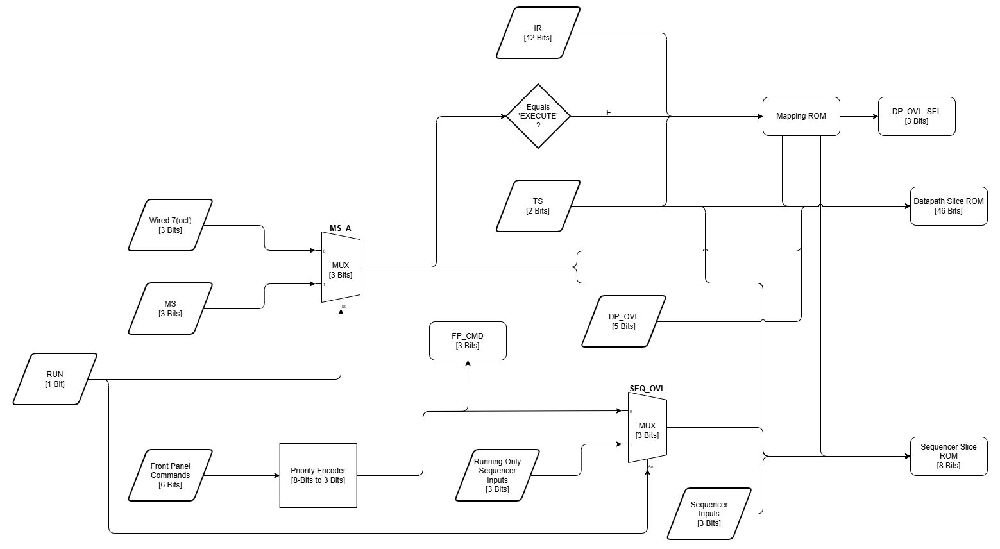
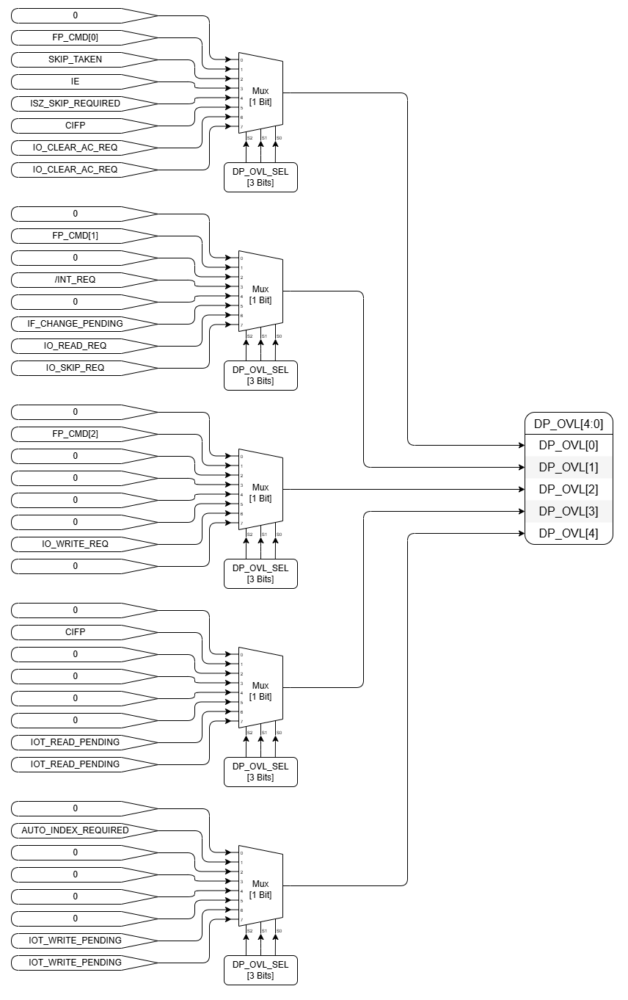

# Control Store Organization

## 1. Purpose

Defines the physical organization of the control store: how the logical control function of [Control Addressing](./02-control-addressing.md) and the logical [Control Word](./04-control-word.md) are realized in memory devices and discrete multiplexers.

This document establishes:

- the device technology and its constraints
- how the control store is divided into independently addressed parts, and the fields each part produces
- the ROM stage that translates the instruction into address information
- the address map of each part, including address bits shared among condition inputs
- how control-word fields are packed into device outputs
- what the ROM-generation tools must verify

The logical control word, the control inputs, and the behavior they select are defined elsewhere and are not changed by this document.

### 1.1 Terms

| Term | Meaning |
|---|---|
| slice | a part of the control store that produces a fixed subset of control-word fields from its own address ([Control Addressing §2.1](./02-control-addressing.md#21-partitioned-and-two-level-control-stores)) |
| sequencer slice | the slice producing `MS_NEXT`, `MS_LOAD`, `RUN_NEXT`, `HLT_REQ_NEXT`, `/DMA_GRANT`, and `/INITIALIZE` (section 4.1) |
| datapath slice | the slice producing every encoded field except the sequencer fields (section 4.2) |
| `MS_A` | the 3-bit major-state code presented to the control store: `MS` while running, code 7 while halted (section 5.1); the `MS` register itself is unchanged |
| `E` | 1 when `MS_A` is EXECUTE (code 2), else 0; equivalently, `MS = EXECUTE` and `RUN = 1` |
| mapping ROM | ROM devices inside the control store that map IR, TS, and `E` to the instruction-dependent part of the slice addresses; the mapping stage of [Control Addressing §2.1](./02-control-addressing.md#21-partitioned-and-two-level-control-stores). The name follows the mapping PROMs of microprogrammed machines, which map an instruction to its microprogram |
| `VARIANT` | a 5-bit mapping ROM output identifying the instruction-dependent behavior that applies in the current TS of EXECUTE |
| overlay | an address field that carries different condition inputs in different contexts ([Control Addressing §6.3](./02-control-addressing.md#63-domain-separation)) |
| `DP_OVL[4:0]` | the datapath slice's 5-bit overlay field |
| overlay group | one fixed assignment of condition inputs to `DP_OVL[4:0]` |
| `DP_OVL_SEL` | a 3-bit mapping ROM output selecting which overlay group drives `DP_OVL[4:0]` (section 6) |
| `FP_CMD[2:0]` | the encoded front-panel command (section 5.2) |
| `SEQ_OVL[2:0]` | the sequencer slice's 3-bit overlay field: the running-only sequencer inputs while running, `FP_CMD[2:0]` while halted (section 5.5) |
| `IR_SEQ` | the 3-bit mapping ROM output carrying the instruction decodes the sequencer slice needs: `IR_INDIRECT`, `IR_OPR_HLT`, `IR_IS_CAF` |
| 28C256 | a parallel EEPROM with 15 address bits and 8 data bits (32K × 8) |

Status: the slice structure, device technology, and packing rules are design decisions. The specific address-bit assignments, variant counts, and overlay groups are the current proposal, measured from the maintained specifications; the packing tool will finalize and verify them.

---

## 2. Design Constraints

| Constraint | Consequence |
|---|---|
| Control logic is discrete: memory devices and standard discrete logic only; no PAL, GAL, CPLD, or FPGA | Every function wider than a few gates is a ROM lookup; glue is limited to multiplexers, encoders, and latches |
| Control-store devices are parallel EEPROMs (28C256 class: 15 address bits, 8 data bits) | Each slice address is at most 15 bits; each device supplies 8 control-word bits |
| Device count matters but is not the primary concern | Control-word width, not address depth, sets the device count; width is reduced where it costs no logic |

The control store is sparse: most addresses are unreachable or repeat another address's word. Sparsity is permitted ([Control Addressing §7.2](./02-control-addressing.md#72-sparsity)).

---

## 3. Overview



The datapath overlay, which produces `DP_OVL[4:0]`, is drawn separately in section 6.

Signal flow:

- `MS` and `RUN` form `MS_A`; `MS_A` is compared with EXECUTE to form `E`.
- The front-panel commands are encoded into `FP_CMD[2:0]`.
- The mapping ROM reads `IR`, `TS`, and `E`. Its single output word holds three fields, and each field is an address input of a different part of the control store:
  - `VARIANT` → datapath slice
  - `IR_SEQ` → sequencer slice
  - `DP_OVL_SEL` → datapath overlay
- The datapath overlay presents the runtime conditions or `FP_CMD` selected by `DP_OVL_SEL` on `DP_OVL[4:0]` (section 6).
- The datapath slice reads `MS_A`, `TS`, `VARIANT`, and `DP_OVL[4:0]`.
- The sequencer slice reads `MS_A`, `TS`, the sequencer inputs, `SEQ_OVL[2:0]`, and `IR_SEQ`.

No field of the mapping ROM's output reaches the datapath or the sequencing logic directly; every field is used only to address the slice ROMs or to select the overlay.

---

## 4. Slices

The control store is partitioned into two slices ([Control Addressing §2.1](./02-control-addressing.md#21-partitioned-and-two-level-control-stores)). Every encoded control-word field is produced by exactly one slice.

### 4.1 Sequencer Slice

Fields:

```
MS_NEXT, MS_LOAD, RUN_NEXT, HLT_REQ_NEXT, /DMA_GRANT, /INITIALIZE
```

These fields depend on the same small set of inputs in every major state: run control, halt and front-panel inputs, the interrupt and DMA requests, and three instruction decodes. Separating them keeps those inputs out of the datapath slice address.

Width: 8 bits, one device.

### 4.2 Datapath Slice

Fields: every other encoded field of the control word, including the external-IOT transfer and interface fields.

Width: 46 bits after packing (section 7), six devices.

---

## 5. Address Formation

### 5.1 Major-State Code

`MS` uses five of its eight codes (`FETCH = 0`, `DEFER = 1`, `EXECUTE = 2`, `INTERRUPT = 3`, `DMA = 4`). The control store sees:

```
MS_A = 7    if RUN = 0
MS_A = MS   otherwise
```

realized by a 3-bit 2:1 multiplexer selected by `RUN`. Code 7 is the halted pseudo-state; no separate `RUN` address bit is needed.

`MS` itself is not changed while halted. It keeps the held major state, because CONTINUE resumes at TS1 of the held state ([Major State Timing §8.1](../09-timing/03-major-state-timing.md#81-main-timing-while-halted)), and because the DMA arbiter observes `MS` directly. Only the control store sees code 7.

The substitution loses no information the control store needs: while halted, no control word depends on which major state is held, and while running, `MS_A = MS`. It replaces a `RUN` address bit that would not fit in the 15-bit datapath slice address.

`E` is produced by comparing `MS_A` with the EXECUTE code.

### 5.2 Front-Panel Command Code

Console commands are accepted at most one at a time ([External Inputs §4.1](./10-control-input-definitions/04-external-inputs.md#41-console-command-acceptance)). A priority encoder encodes them into `FP_CMD[2:0]`:

| `FP_CMD` | Command |
|---|---|
| 0 | none |
| 1 | `FP_START` |
| 2 | `FP_CONTINUE` |
| 3 | `FP_CLEAR` |
| 4 | `FP_LOAD_ADDRESS` |
| 5 | `FP_EXAMINE` |
| 6 | `FP_DEPOSIT` |

### 5.3 Mapping ROM

The mapping ROM ([Control Addressing §2.1](./02-control-addressing.md#21-partitioned-and-two-level-control-stores)) maps the instruction to the address information each slice needs.

Address (both devices, in parallel):

```
A14..A3 = IR[11:0]
A2..A1  = TS
A0      = E
```

Output fields:

| Field | Width | Meaning |
|---|---|---|
| `VARIANT` | 5 | the instruction-dependent behavior that applies in this TS of EXECUTE; a fixed value when `E = 0` |
| `DP_OVL_SEL` | 3 | the overlay group presented to the datapath slice (section 6) |
| `IR_SEQ` | 3 | `IR_INDIRECT`, `IR_OPR_HLT`, `IR_IS_CAF` for the sequencer slice |
| spare | 5 | unassigned |

Two IR values share a variant only when they produce the same datapath words for every condition value in that TS. The current specification needs at most 26 variants in one TS (EXECUTE TS2), within the 32 that `VARIANT` allows. A single variant code shared by all four timing states would need 227 values, which is why the mapping ROM is indexed by TS.

The instruction-dependent conditions that select behavior within a case, such as OPR micro-operation bits and memory-extension decodes, are absorbed into the variant. Only runtime conditions reach the address through the overlay.

### 5.4 Datapath Slice Address

```
A14..A12 = MS_A
A11..A10 = TS
A9..A5   = VARIANT
A4..A0   = DP_OVL[4:0]
```

### 5.5 Sequencer Slice Address

Address, in every run mode:

```
A14..A12 = MS_A
A11..A10 = TS
A9       = HLT_REQ
A8       = FP_STOP
A7..A5   = SEQ_OVL[2:0]
A4       = /DMA_REQ
A3..A1   = IR_SEQ
A0       = 0
```

`SEQ_OVL[2:0]` is a 3-bit 2:1 multiplexer selected by `RUN`:

| `RUN` | `SEQ_OVL[2]` | `SEQ_OVL[1]` | `SEQ_OVL[0]` |
|---|---|---|---|
| 0 (halted) | `FP_CMD[2]` | `FP_CMD[1]` | `FP_CMD[0]` |
| 1 (running) | `FP_SINGLE_INSTRUCTION` | `FP_SINGLE_STEP` | `INTERRUPT_REQUEST_VALID` |

While halted, the running-only inputs cannot change the sequencer word and the front-panel command can; while running, the reverse holds.

---

## 6. Datapath Overlay



The five overlay bits `DP_OVL[4:0]` are driven by five 8:1 multiplexers, one per bit, all selected by `DP_OVL_SEL[2:0]`. Input *n* of every multiplexer belongs to overlay group *n*, so `DP_OVL_SEL = n` presents group *n* on `DP_OVL[4:0]`. Each group presents the runtime conditions that can change the datapath word in its contexts ([Control Addressing §6.3](./02-control-addressing.md#63-domain-separation)).

### 6.1 Overlay Groups

| Input / `DP_OVL_SEL` | Group | Used in |
|---|---|---|
| 0 | none | contexts with no runtime condition |
| 1 | state | FETCH, DEFER, INTERRUPT, DMA, halted |
| 2 | skip | OPR Group 2 TS1 |
| 3 | interrupt | SKON, SRQ |
| 4 | ISZ | ISZ TS4 |
| 5 | field change | JMP, JMS TS4 |
| 6 | external IOT TS1–TS3 | external-IOT EXECUTE TS1–TS3 |
| 7 | external IOT TS4 | external-IOT EXECUTE TS4 |

### 6.2 Multiplexer Inputs

Current assignment; `0` is tied low:

| Input (group) | `DP_OVL[4]` | `DP_OVL[3]` | `DP_OVL[2]` | `DP_OVL[1]` | `DP_OVL[0]` |
|---|---|---|---|---|---|
| 0 (none) | 0 | 0 | 0 | 0 | 0 |
| 1 (state) | `AUTO_INDEX_REQUIRED` | `CIFP` | `FP_CMD[2]` | `FP_CMD[1]` | `FP_CMD[0]` |
| 2 (skip) | 0 | 0 | 0 | 0 | `SKIP_TAKEN` |
| 3 (interrupt) | 0 | 0 | 0 | `/INT_REQ` | `IE` |
| 4 (ISZ) | 0 | 0 | 0 | 0 | `ISZ_SKIP_REQUIRED` |
| 5 (field change) | 0 | 0 | 0 | `IF_CHANGE_PENDING` | `CIFP` |
| 6 (external IOT TS1–TS3) | `IOT_WRITE_PENDING` | `IOT_READ_PENDING` | `IO_WRITE_REQ` | `IO_READ_REQ` | `IO_CLEAR_AC_REQ` |
| 7 (external IOT TS4) | `IOT_WRITE_PENDING` | `IOT_READ_PENDING` | 0 | `IO_SKIP_REQ` | `IO_CLEAR_AC_REQ` |

Sixteen distinct signals drive 20 of the 40 inputs: the 13 runtime conditions and the three `FP_CMD` bits. `CIFP`, `IO_CLEAR_AC_REQ`, `IOT_READ_PENDING`, and `IOT_WRITE_PENDING` each drive two inputs.

Which bit a signal occupies within its group is arbitrary; the packing tool may reassign it. Group 7 relies on the TS4 request window ([Major State Timing §5.2.7](../09-timing/03-major-state-timing.md#527-ts4)), which excludes `IO_READ_REQ` and `IO_WRITE_REQ` in TS4.

---

## 7. Control-Word Packing

### 7.1 Hardwired Constants

Constant sources are hardwired in the datapath rather than supplied by value fields: `IF_SRC = 0` (zero), `MA_SRC = 2` (zero), `PC_SRC = 1` (0001). See [Microarchitectural Control Signals](./20-control-output-definitions/01-microarchitectural-control-signals.md).

### 7.2 Physical Bit Sharing

Fields that never require a value in the same control word share device outputs ([Control Word §5.6](./04-control-word.md#56-physical-bit-sharing)). The current packing:

| Bits | Fields |
|---|---|
| 4 | `ALU_OP`, `DF_VAL` |
| 3 | `AC_SRC`, `DIF_VAL`, `MA_SRC` |
| 3 | `ALU_B_SRC`, `DF_SRC` |
| 2 | `ALU_A_SRC`, `DIF_SRC` |
| 2 | `IF_SRC`, `IOT_TRANSFER_VAL`, `L_OP`, `MB_SRC` |
| 1 | `AB_SRC`, `CIFP_VAL`, `MQ_SRC` |
| 1 | `EA_ADDR_SRC`, `IE_VAL` |
| 1 | `II_VAL`, `PC_SRC` |
| 29 | the remaining fields, one bit each |

Total: 46 bits in six devices, two bits spare.

A field shares bits only through wiring. No decoder or gate follows the control store ([Control Addressing §2](./02-control-addressing.md#2-control-address-definition)).

---

## 8. Device Summary

| Function | Devices |
|---|---|
| Mapping ROM | 2 × 28C256 |
| Datapath slice | 6 × 28C256 |
| Sequencer slice | 1 × 28C256 |
| `MS_A` select | 3-bit 2:1 multiplexer |
| `SEQ_OVL` select | 3-bit 2:1 multiplexer |
| `E` | comparator for the EXECUTE code |
| `FP_CMD` | 8-to-3 priority encoder |
| Datapath overlay | five 8:1 multiplexers |

Total: 9 EEPROMs, plus the multiplexers, comparator, and encoder.

The second mapping ROM device exists for `IR_SEQ` and has five spare outputs. Section 10 lists ways to remove it.

---

## 9. Verification

The ROM-generation tools produce every device image from the maintained specifications and must verify that, for every reachable input state:

- the mapping ROM, overlays, and slices together select the symbolic control word of the applicable execution case
- every field whose Value Required When condition holds has its required value after bit sharing is undone
- no address bit carries an input that the address map does not assign to it in that context

Reachability is defined by the input constraints, IR derivations, timing constraints, and state invariants already used by the symbolic generator and the equivalence analyzer.

---

## 10. Open Items

- **Timing:** EEPROM access time plus the mapping ROM and overlay must fit within the TS evaluation window ([Control Addressing §9](./02-control-addressing.md#9-timing-model)). Whether the control word passes through a pipeline register is not yet defined.
- **Power-on state:** the TSEQ, MS, and RUN power-on state is not yet defined ([Timing Terminology](../09-timing/01-terminology.md)); every device image must define the reset address's word once it is.
- **Datapath diagrams:** datapath diagrams that show a control-supplied input on the IF, MA, or PC source multiplexers must show the hardwired constants instead.
- **Group assignments:** the overlay groups and variant counts in sections 5 and 6 come from the current specification and may change when the packing tool assigns them.
- **Second mapping ROM device:** two ways may remove it, bringing the total to 8 EEPROMs:
  - Each timing state appears to need at most one of the three `IR_SEQ` decodes (`IR_INDIRECT` in FETCH TS4, `IR_OPR_HLT` in EXECUTE TS3, `IR_IS_CAF` in EXECUTE TS4). Because the mapping ROM is indexed by TS and `E`, it could output a single bit carrying whichever decode applies, which also frees two sequencer address bits. That bit fits in one device only if `VARIANT` and `DP_OVL_SEL` together shrink to 7 bits, for example by merging overlay groups so that `DP_OVL_SEL` needs 2 bits. Half of the overlay multiplexer inputs are tied low (section 6.2), so some merging appears possible.
  - Generating `IR_SEQ` with discrete decoding logic instead: three IR decodes, each a comparison of a few IR bits.

  The packing tool will determine whether the first option fits.
