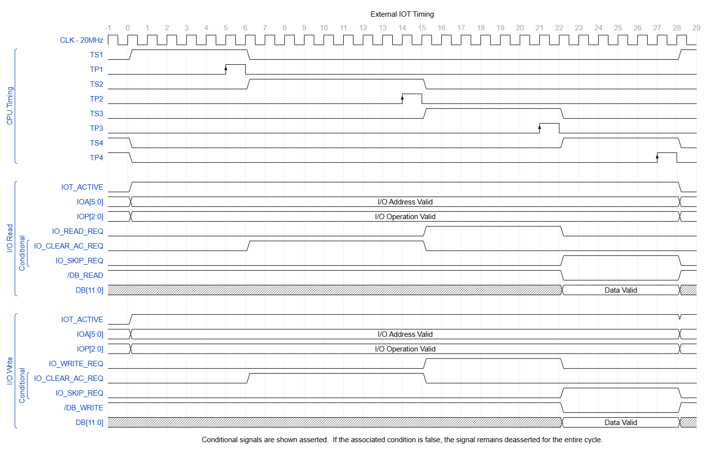

# I/O Timing

## 1. Purpose

This document defines external-IOT phase usage, TP commit rules, and controller timing participation.

---

## 2. Shared Timing Interface

TS and TP signals are exposed to external controllers through the I/O interface.

Controllers use the shared TP events directly. Dedicated I/O commit strobes are not defined.

TP is one shared signal, and TS identifies which TP it is:

- As TP rises, a controller captures, using TS as a synchronous enable.
- As TP falls, the controller's responses, requests, and driven values show the result ([Timing Architecture §7.6](../09-timing/02-timing-architecture.md#76-rule-6--two-ranks)).

All controller-local state changes caused by an IOT occur only at TP events.

### 2.1 Initialization Timing

For CAF:
- /INITIALIZE is asserted during EXECUTE TS4.
- All processor and controller initialization effects commit at TP4.
- No CAF initialization effect occurs before TP4.
- /INITIALIZE is deasserted when EXECUTE TS4 ends.

For an accepted front-panel CLEAR or START operation, and the CLEAR transaction that ends the power-on reset ([Timing Terminology §3.4](../09-timing/01-terminology.md#34-power-on-reset)):
- the processor is halted
- /INITIALIZE is asserted for the whole console transaction ([Major State Timing §8](../09-timing/03-major-state-timing.md#8-halted-state-and-console-transactions))
- all processor and controller initialization effects commit at the console TP (`TP_FP`) ending that transaction; TP_FP is presented to controllers as a TP event
- /INITIALIZE is deasserted when the transaction ends

/INITIALIZE:
- does not depend on IOT_ACTIVE, IOA, IOP, /DMA_GRANT, or DMA_GRANT_ID
- overrides all controller actions that would otherwise commit at the same TP
- causes only the controller's documented initialized state to commit at that TP

---

## 3. IOT Phase Allocation

### 3.1 External-IOT Timing Overview

The following diagram shows representative external-IOT read and write timing.

The diagram shows the following sequence:

- `IOT_ACTIVE`, `IOA`, and `IOP` remain valid throughout the external-IOT EXECUTE major state.
- A selected controller presents `IO_READ_REQ` or `IO_WRITE_REQ` during TS3.
- CPU control accepts the request at TP3.
- CPU control asserts `/DB_READ` or `/DB_WRITE` during TS4.
- DB remains valid through TP4.
- The requested data transfer commits at TP4.
- The diagram shows a representative `IO_CLEAR_AC_REQ` asserted during TS2 and committed at TP2.
- Controller-specific operations may instead assert `IO_CLEAR_AC_REQ` during TS3 or TS4, provided AC clear does not commit at the same TP as a pending read transfer.
- `IO_SKIP_REQ`, when its condition is true, is asserted during TS4 and commits at TP4.

Conditional signals are shown asserted. When the corresponding condition is false, the signal remains deasserted for the complete cycle.

The waveform is representative. Device-specific controller documents define which response signals are required by each IOT.

### 3.2 TS1: Selection and Decode

During TS1:

- `IOT_ACTIVE` is asserted
- IOA is valid
- IOP is valid
- controllers evaluate address match
- the selected controller decodes IOP
- no controller action commits at TP1

TS1 is the I/O selection and operation-decode phase.

### 3.3 TS2 through TS4: Execution

The selected controller may request actions during TS2 through TS4, subject to the constraints in [External IOT Interface](./02-external-iot-interface.md).

Direct response timing:

- `IO_CLEAR_AC_REQ` asserted during a TS requests AC clear at the following TP.
- `IO_SKIP_REQ` is valid only during TS4 and requests PC increment at TP4.
- A response must be stable at least `T_CS` before the TP that accepts it, because the control word must settle again after it changes ([Timing Architecture §11.4](../09-timing/02-timing-architecture.md#114-timing-budget)).

DB transfer request timing:

- `IO_READ_REQ` or `IO_WRITE_REQ` asserted during a TS is accepted by CPU control at the following TP.
- CPU control asserts `/DB_READ` or `/DB_WRITE` during the next TS.
- The corresponding DB transfer commits at the following TP.
- A DB transfer request must occur early enough for its transfer phase and commit TP to remain within the current external-IOT EXECUTE major state.

For the standard external-IOT read and write timing:

- the selected controller asserts `IO_READ_REQ` or `IO_WRITE_REQ` during TS3
- CPU control accepts the request at TP3
- CPU control asserts `/DB_READ` or `/DB_WRITE` during TS4
- the DB transfer commits at TP4

---

## 4. TP4 Sequencing Boundary

Device actions may commit at TP4 while CPU sequencing and interrupt decisions also commit at TP4.

Constraints:

- TP4 sequencing and interrupt decisions must depend only on state and inputs available at completion of TP3.
- A controller result committed at TP4 cannot affect the sequencing or interrupt decision committed at TP4. An IOT that clears an interrupt condition or a DMA request therefore commits the clear by TP3 ([Controller Contract §9.1](./04-controller-contract.md#91-interrupt-contribution)).
- A controller may assert `/INT_REQ` during TS4 when the assertion depends only on registered controller state available before TP4.
- DB ownership must end before ownership changes for the following major state.

---

## 5. Fixed IOT Timing

The external-IOT timing is fixed. A controller cannot lengthen it: there is no wait signal. Every TS length depends only on state committed by the previous TP ([Timing Terminology §3.5](../09-timing/01-terminology.md#35-timing-rom)), and a wait that a controller asserts during a TS would not.

A controller that cannot complete an operation within this timing reports completion through a flag, which the program tests with a skip IOT or which raises an interrupt, as almost all PDP-8 peripherals do.

If real hardware needs a longer IOT, the fallback is a fixed extension that keeps the rule:

- The selected controller requests a slow TS3 during TS2.
- CPU control registers the request at TP2.
- The timing ROM reads the registered bit as an address input and lengthens TS3 by a fixed number of TSTEPs.

The PDP-8/E's NOT LAST TRANSFER, which stops the processor timing in TS3 until the device negates it and generates BUS STROBE (PDP-8/E Maintenance Manual, volume 1, §3.9.5, p. 3-34), is asynchronous and is not used.

Some DEC options depend on NOT LAST TRANSFER, so a compatible controller for one of them needs a flag-based design or the fixed extension above:

- the KE8-E Extended Arithmetic Element, which runs its own timing chain within the instruction (PDP-8/E Maintenance Manual, volume 2, §1.24, p. 1-37)
- the KG8-E parity generator/detector, whose result reaches the data lines too late for TP3 (volume 3, §6.7, p. 6-17)
- the TA8-E cassette interface, which switches its C lines during an instruction to clear AC and read status in one IOT (volume 3, §10.9 and §10.12.1, pp. 10-11 and 10-15)
- the TM8-E magtape control, whose data-late error check stops the processor timing at TP3 (volume 3, §9.13.7, p. 9-83)
- any peripheral attached through the KA8-E positive I/O bus interface (volume 1, §3.9.5, p. 3-34)

The KL8E, PC8E, and RK8E controllers defined here need neither; the RK8-E's operations complete through Done and DMA (volume 3, chapter 11).

---

## 6. Phase-Specific Response Signals

The following signals apply only to one assigned TS:

- `IO_READ_REQ`
- `IO_WRITE_REQ`
- `IO_CLEAR_AC_REQ`
- `IO_SKIP_REQ`

Rules:

- A phase-specific response is asserted only during its assigned TS.
- The response must be stable at least `T_CS` before the TP that accepts it (section 3.3).
- The response must remain stable through that TP.
- The response is released no earlier than the end of that TP, which supplies its hold interval.
- A response asserted during one TS does not remain effective during a later TS.
- A controller must assert the response again if another action is required during a later phase.
- A response must be derived from stable registered controller state, IOT selection, IOP decode, and the current TS.
- `IO_READ_REQ` and `IO_WRITE_REQ` request a DB transfer during the following TS and TP.
- `IO_CLEAR_AC_REQ` requests AC clear at the immediately following TP.
- `IO_SKIP_REQ` is valid only during TS4 and requests PC increment at TP4.

---

## 7. Persistent Service Requests

The following signals represent persistent requests rather than phase-specific actions:

- controller interrupt contribution
- `/DMA_REQ[n]`
- aggregate `/INT_REQ`

Rules:

- A persistent request remains asserted while its underlying request condition remains true.
- A persistent request is not consumed merely because it is sampled.
- The owning controller or arbiter deasserts the request only when the condition is cleared, serviced, completed, canceled, or otherwise removed by its contract.
- Persistent requests may span multiple TS, TP, and major-state boundaries.
- Aggregate `/INT_REQ` remains asserted while at least one controller interrupt contribution remains asserted.
- Aggregate `/DMA_REQ` is qualified by the combinational arbiter output `DMA_ENABLE`.
- Aggregate `/DMA_REQ` may be deasserted while one or more controller `/DMA_REQ[n]` lines remain asserted.
- Separate combinational aggregation logic continuously derives aggregate `/DMA_REQ` from `DMA_ENABLE` and `/DMA_REQ[14:0]`, as defined in [DMA Arbitration](./06-dma-arbitration.md).

---

## 8. Grant Signals

The DMA authorization and selection interface consists of:

- /DMA_GRANT
- DMA_GRANT_ID[3:0]

/DMA_GRANT is produced by CPU control and indicates that the CPU has released the memory interface during MS = DMA.  
DMA_GRANT_ID is produced by the DMA arbiter and identifies the selected DMA priority channel.

Rules:

- DMA_GRANT_ID values 0 through 14 identify valid configured DMA priority channels.
- DMA_GRANT_ID value 15 indicates that no controller is selected.
- The arbiter must drive DMA_GRANT_ID to 15 whenever no valid controller selection exists.
- DMA_GRANT_ID must identify a valid selected controller before that controller drives any DMA-owned interface.
- DMA_GRANT_ID remains stable for the complete active controller selection.
- Grant identity must not change during a bounded burst.
- A controller may act only when /DMA_GRANT is asserted and DMA_GRANT_ID matches its configured DMA priority.
- No controller may act while DMA_GRANT_ID is 15.
- Grant withdrawal follows the ownership-release ordering defined in [DMA Arbitration](./06-dma-arbitration.md).

---

## 9. Data and Address Signals

Controller-driven DB, MFB, AB, and MDB values are transfer-specific signals.

Rules:

- A controller-driven value must be valid before the TP that samples it.
- The value must remain stable through the end of the sampling TP, which supplies the hold interval after the capture at its leading edge.
- The controller must release the applicable bus before ownership transfers to another participant.
- MFB and AB must remain stable while /RD is asserted, and from before the leading edge through the end of a write's TP.

---

## 10. Synchronization Boundary

Every controller output that CPU control uses is registered and changes only as a TP ends, so the CPU adds no synchronizer to it ([External Inputs §2](../04-control/10-control-input-definitions/04-external-inputs.md#2-timing-model)). Each controller synchronizes its own physical-device events ([Controller Contract](./04-controller-contract.md)). The controller contract must prevent asynchronous state changes or repeated commit events.

---

## 11. Related Documents

- [Timing Architecture](../09-timing/02-timing-architecture.md)
- [External IOT Interface](./02-external-iot-interface.md)
- [Controller Contract](./04-controller-contract.md)
