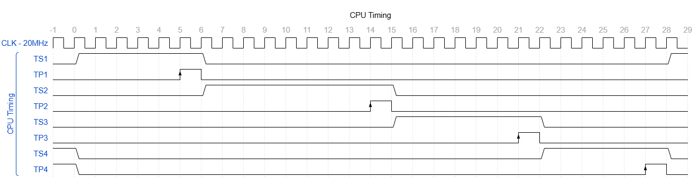

# Timing Architecture

## 1. Purpose

This document defines the structure and rules of the timing system.

It describes:
- how time is represented
- how events are scheduled
- how execution is sequenced

---

## 2. CPU Timing Overview

The CPU timing model is illustrated in the following diagram:



This diagram represents the canonical timing structure:
- Timing States (TS) define phase windows
- Timing Pulses (TP) define execution events
- All actions occur at TP events

---

## 3. Timing Model Overview

The system uses a layered timing model:

TCLK → TSTEP → TP → TS  

with a separate control layer:

MS (Major State)

### 3.1 Signal Polarity Convention

TP and TS signals are active-high.

- TP signals are positive pulses.
- TS signals are positive phase windows.
- A TS signal is asserted high while its corresponding phase is active.
- A TP signal is asserted high for its corresponding commit event.

The timing diagrams show the actual electrical levels of both signal classes.

---

## 4. Timing Sequence

### 4.1 Timing Progression

On each rising edge of TCLK:

- TSTEP advances to the next step of the current TS, or after the last step of the TS's TP to step 1 of the next TS.
- Exactly one TSTEP remains active.

---

### 4.2 Timing Pulses

Each TS ends with its TP:

TPn = active during the last W steps of TSn ([Timing Terminology §3.5](./01-terminology.md#35-timing-rom))

TP is:
- one timing step wide, or two in a TS that can write memory (section 5.1)
- driven by a flip-flop ([Timing Terminology §4.4](./01-terminology.md#44-generation))
- aligned to the rising edge of TCLK
- the only event trigger in the system

---

## 5. Timing States

### 5.1 Structure

Each timing state is a run of N timing steps, N read from the timing ROM ([Timing Terminology §3.5](./01-terminology.md#35-timing-rom)). TSTEP is 50 ns (TCLK = 20 MHz). The lengths, in TSTEPs (TS1/TS2/TS3/TS4):

| Context | Mode 0 (optimized) | Mode 1 (uniform slow) |
|---|---|---|
| FETCH; DEFER with `AUTO_INDEX_REQUIRED = 0` | **5/8/6/5 = 24 (1.20 µs)** | 6/8/7/7 = 28 (1.40 µs) |
| DEFER with `AUTO_INDEX_REQUIRED = 1`; EXECUTE; INTERRUPT; DMA | **6/8/7/7 = 28 (1.40 µs)** | 6/8/7/7 = 28 (1.40 µs) |

The lengths include TP. TP is two steps wide, in both modes, in the TSs that can write memory, and one step wide in every other TS:

| Context | TSs with a two-step TP | Writer |
|---|---|---|
| DEFER with `AUTO_INDEX_REQUIRED = 1` | TS4 | auto-index write-back |
| EXECUTE, whatever the instruction | TS3, TS4 | DCA and JMS in TS3; ISZ in TS4 |
| INTERRUPT | TS3 | return address |
| DMA | TS2 | controller |
| Console transaction | TPC | DEPOSIT |

`TIMING_MODE` codes 2 and 3 are reserved. Mode 0 is the normal mode; mode 1 is for hardware bring-up.

The two lengths follow the PDP-8/E's fast and slow memory cycles (KK8-E; M8330):

- **Which states are slow:** FETCH and non-autoindex DEFER are fast; EXECUTE and autoindex DEFER are slow. The slow cycle lengthens the TSs of a state that writes memory, or may write it: the auto-index write-back, the MRI and interrupt writes, and a DMA transfer.
- **Matching the PDP-8/E:** under mode 0, a directly addressed memory-reference instruction takes 2.6 µs, as on the PDP-8/E.
- **The diagnostic check:** the ISZ + JMP loop of a timing routine takes 2 × 24 + 28 = 76 TSTEPs = 3.80 µs, the PDP-8/E figure that MAINDEC-8E-D2AB checks.

Each length allows the TS's longest path, from its control word and memory access to the leading edge of its TP, within the limits of section 11.4, and is padded to these totals. TS2 is the longest setup interval, to accommodate the memory access.

See: [cpu-timing-overview](../../diagrams/timing/cpu-timing/export/cpu-timing-overview.png)

---

### 5.2 Function

TS provides:

- setup intervals
- stable conditions
- enabled datapaths

TS signals represent **phase windows**, not events.

Transitions of TS do not cause state changes.

---

## 6. Event Semantics

### 6.1 Core Rule

TS defines when an operation is allowed  
TP defines when the operation occurs  

---

### 6.2 Execution Pattern

TSn:
  data stabilizes

TPn:
  data is captured at the leading edge, and published as TP ends

TS(n+1):
  results are used

---

### 6.3 Diagram Interpretation

As shown in the CPU timing overview diagram:

- TS signals are represented as level signals (windows)
- TP signals are represented as event markers (arrows)
- Only TP markers indicate execution events
- TS edges represent phase transitions only and have no event semantics

---

## 7. State Change Rules

### 7.1 Rule 1 — Event-Driven Updates

All state changes occur on TP events: a register captures at the leading edge of TP and publishes as TP ends, and a memory write completes within the TP.

---

### 7.2 Rule 2 — Setup Before Event

All inputs must be stable before the leading edge of TP and through the end of TP. They must derive only from state committed by the previous TP. Apart from TP itself, an edge or level that arises during a TS commits nothing and selects nothing.

---

### 7.3 Rule 3 — Phase Transition

TS transitions occur as TP ends: one TSTEP after its leading edge, or two for a two-step TP. That is also when the state committed at the TP becomes visible.

---

### 7.4 Rule 4 — No Level-Driven Behavior

No state changes occur directly from TS levels.

---

### 7.5 Rule 5 — Capture Only on the Leading Edge

Only the TP rising (leading) edge captures data. The end of TP captures nothing from the datapath: it publishes what the leading edge captured.

---

### 7.6 Rule 6 — Two Ranks

Every register that holds machine state, in the CPU, the controllers, and the DMA arbiter, has two ranks. The timing generator's own flip-flops (TSEQ, TP, the TS code, and the validity windows) have one.

| Rank | Clocked at | Takes | Read by |
|---|---|---|---|
| r1, capture | the leading edge of TP, if the register is selected to load | the register's selected input | r2 only |
| r2, output | the end of every TP | r1 | everything else: datapath, buses, control store, decodes, displays |

One signal is decoded between the ranks: `MS_EFF_IS_EXECUTE` ([Control Store Organization §5.1](../04-control/08-control-store-organization.md#51-major-state-and-timing-state-codes)).

In a two-step TP:

```text
                           leading       one TSTEP           end
                              |               |               |
TP (two-step)     ____________|‾‾‾‾‾‾‾‾‾‾‾‾‾‾‾‾‾‾‾‾‾‾‾‾‾‾‾‾‾‾‾|_____________
TS                =================== TSn ====================X== TS(n+1) ==
r1 input          = settling =|========= valid, held =========X
r1                === old ====X==================== new ====================
r2 (visible)      =================== old ====================X==== new ====
/WR_PULSE         ‾‾‾‾‾‾‾‾‾‾‾‾|_______________|‾‾‾‾‾‾‾‾‾‾‾‾‾‾‾‾‾‾‾‾‾‾‾‾‾‾‾‾‾
```

A one-step TP ends one TSTEP after its leading edge and has no write pulse.

- r2 does not change during TP, so no r1 input, bus value, select, or control-word bit changes during TP. This supplies the hold time of every capture, on and off the CPU board.
- r1 does not change between the leading edge and the end of TP, so r2 has no race with it. The two ranks must not be clocked by the same edge.
- A register may be both a source and a destination at one TP, and a register selected onto a bus may load at that TP: the source is r2, which still holds the old value.
- Where the documents say that a register loads, or that state commits, at TPn, r1 captures at TPn's leading edge and the value is visible from TS(n+1).

---

## 8. Major State Integration

### 8.1 Role of MS

MS defines:
- operation type
- control flow

---

### 8.2 Relationship

MS operates over one or more TS/TP cycles:

MS → TS → TP

---

### 8.3 Transitions

Major State changes occur at defined TP events.

---

## 9. Fast vs Slow Timing

### 9.1 Mechanism

Timing speed is controlled by the length of each TS, read from the timing ROM ([Timing Terminology §3.5](./01-terminology.md#35-timing-rom)).

- Fast: a FETCH or non-autoindex DEFER (5/8/6/5 TSTEPs, mode 0)
- Slow: every other major state (6/8/7/7 TSTEPs)

The selection is dynamic, by major state and `AUTO_INDEX_REQUIRED`, within the static `TIMING_MODE` (section 5.1).

---

### 9.2 Effect

- TS duration changes as a result of TSTEP changes
- TP count per cycle does not change: always one TP per TS, four per major state
- MS behavior remains unchanged

---

## 10. DMA Integration

DMA does not inhibit timing progression.
DMA is a control-selected Major State (MS = DMA), sequenced identically to other major states.

Properties:
- TSTEP progression is unaffected by DMA
- TS and TP proceed normally during MS = DMA
- DMA entry and exit are selected through MS_NEXT at TP4

Constraint:
- Timing must not freeze, gate, or skip TSTEP progression for DMA.
- No DMA_HOLD mechanism exists.

DMA sequencing and datapath behavior are defined in:
- [Sequencing Control Signals](../04-control/20-control-output-definitions/03-sequencing-control-signals.md)
- [Datapath Mapping](../04-control/05-datapath-mapping.md)

---

## 11. Control Word Settling

### 11.1 Settling

The control word is formed combinationally from registered state, the timing state, and control inputs ([Control Store Organization](../04-control/08-control-store-organization.md)). It is not registered. After each TS boundary, and after any control input changes, it may take any value for up to `T_CS` before it is stable.

### 11.2 Signal Classes

Every control signal is one of:

- **TP-qualified:** acts only when a TP or TPC commits a result. A transient value has no effect provided the signal is stable before the TP. Register load enables, source selects, ALU fields, value fields, the sequencing fields, and `/WR` are TP-qualified.
- **Immediate-effect:** acts while it is asserted, for example by driving a bus or strobing memory. An immediate-effect signal is presented only within its validity window.

The immediate-effect signals and their windows are defined in [Architectural Control Signals §3.2](../04-control/20-control-output-definitions/02-architectural-control-signals.md#32-timing-model).

An immediate-effect signal must depend only on MS, RUN, TS, IR, registered state, and latched console commands, never on a control input that can change during a TS.

### 11.3 Validity Windows

- `CW_VALID` opens 150 ns (three TSTEPs) into every TS, at least `T_CS` after the TS begins, and closes as TP ends. Signals whose receiver captures them at the TP stay valid through that TP.
- `CW_VALID` is produced by a flip-flop clocked by TCLK, so its edges are fixed TSTEP positions.
- `/WR` needs no window. Memory acts on it only during [`/WR_PULSE`](./01-terminology.md#57-write-pulse-wr_pulse), the first step of a two-step TP, when it is stable (section 7.6).
- `DB_VALID` opens 100 ns into every TS for `/DB_READ` and `/DB_WRITE` ([Timing Terminology §5.8](./01-terminology.md#58-db-transfer-window-db_valid)).

### 11.4 Timing Budget

Budgets are expressed in TSTEPs.

- A path starts as the previous TP ends, when the output ranks and TS change.
- It must settle by the leading edge of this TS's TP.
- A TS of N steps with a W-step TP therefore allows N − W steps, less the output rank's clock-to-output delay.

Those steps must be enough for:

- `T_CS`, before `CW_VALID` opens
- the work done inside the window, such as a memory access in TS2 or the datapath evaluation before TP

The number of TSTEPs in each TS is a design parameter. Adding a TSTEP to one TS lengthens the cycle by one TCLK period, which is the preferred way to gain margin.

A control input that changes during a TS, such as a controller response, must be stable at least `T_CS` before the TP that accepts it.

The budget also sets these limits on the physical design:

- at most 5 ns for each backplane or ribbon crossing
- at most 200 pF on an open-collector line, pulled up by 220 Ω or a termination at least as strong
- at most 50 pF on a logic output, or a buffer included in the budget
- ACT or F parts on every register and timed path, including both ranks in the controllers and the arbiter
- terminated clock and write-pulse lines, with Schmitt-trigger clock receivers on other boards

---

## 12. Summary

The system timing model enforces:

- deterministic execution
- discrete event-driven state changes
- clear separation between:
  - timing (TS, TP)
  - control (MS)

